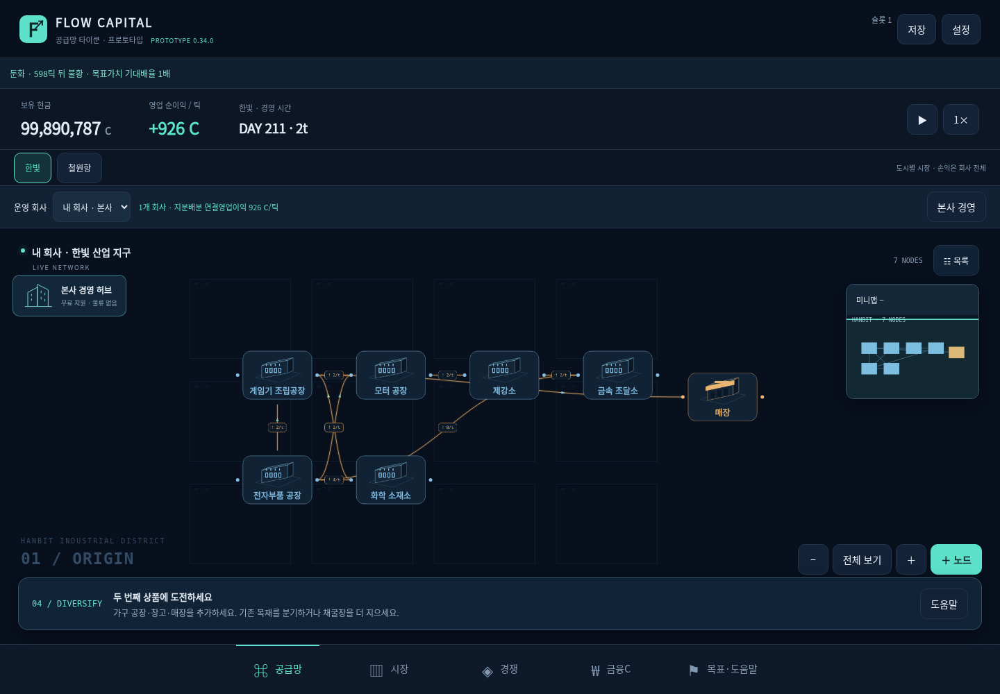
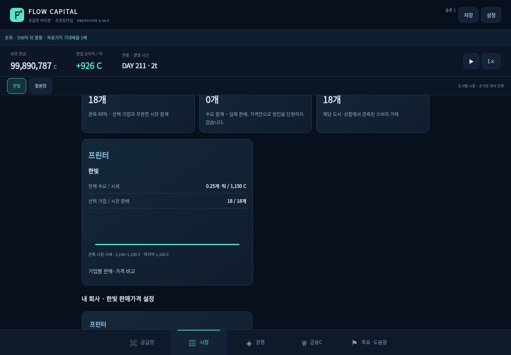
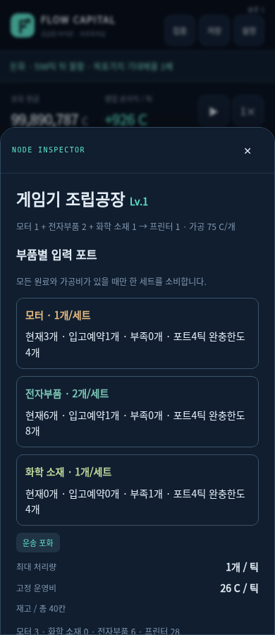

# FLOW CAPITAL

An original Korean-language 2D idle supply-chain management prototype. Current version: **0.34.0**.

[Play](https://sigco3111.github.io/supply-chain-tycoon/) · [Korean guide and full catalog](README.md) · [Development history](docs/DEVELOPMENT_HISTORY.ko.md)

Connect a wood source, paper factory, warehouse and store to make your first sales. Expand through research into food, textiles, electronics, vehicles, data services and industrial sensors. The catalog has60 products:36 consumer products,1 industrial sensor product and23 inputs/intermediates. Shared inputs, city logistics, B2B, ownership and research compete for cash and the40-node-per-company limit.

## Screenshots

Captured from the public0.34.0 build using a test save with extra cash and research. These are not the user's real progress or average returns. The mobile view is Chromium touch emulation, not a real iPhone Safari capture.

### 공급망 네트워크



### 시장과 수요



### 모바일 생산 검사



## Main systems

- Two cities with separate markets and port-to-port transport.
- Integer inventory and cash, atomic multi-input production, reserved inbound capacity and B2B payment escrow.
- Share trading, IPOs, tenders, control and defense. Subsidiary cash remains separate.
- A deterministic four-stage economic cycle begins after150 economic minutes.
- The planner compares cloned scenarios. Delegation applies reviewed inventory bands, replenishment and bounded upgrades to the real game. Delegation startsOFF.
- Three independent local saves. Each slot settles its own elapsed absence, capped at8hours. Offline operation can lose money.

One economic tick is one second at normal speed;60ticks make one game day. Later products need both time gates and their research prerequisites. Recipes are fictional game abstractions, not manufacturing instructions or financial advice.

## 0.34 balance pass

Only three new0.33 reference prices changed: cheese omelet190→230C, printer850→1,150C, robot vacuum850→1,100C. Existing44 product recipes and prices did not change. Input quantities, processing costs, research costs and demand rates did not change. Old user prices, market prices and agreed B2B prices are preserved; old lower price limits remain valid. See the measured conditions in [the balance report](docs/BALANCE_0.34.md).

## Run locally

```bash
python3 -m http.server 8777
node variations-test.mjs
node wrapup-test.mjs
```

Open `http://localhost:8777/`. UI tests need a separate Playwright browser installation.

## Limits

Static prototype, no account or cloud synchronization. Export saves before clearing site data or changing devices. Chromium and Linux WebKit touch emulation have been tested; real iPhone Safari touch, sustained heat, audio and storage persistence have not. Measurements are scenario results, not guaranteed returns. No license has been specified.
