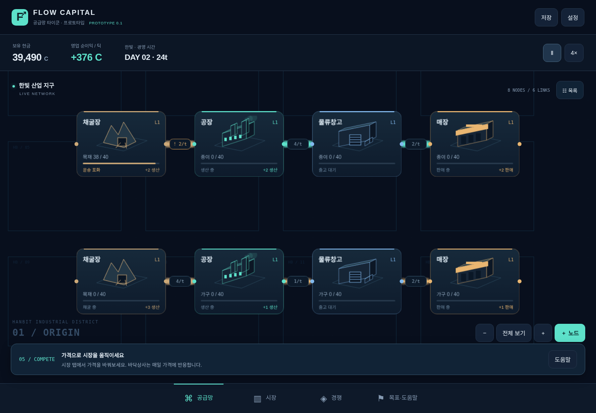
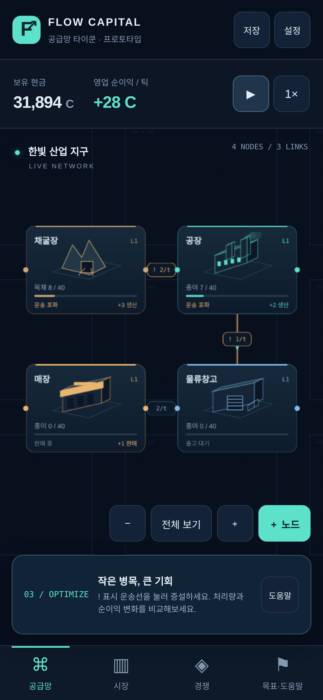
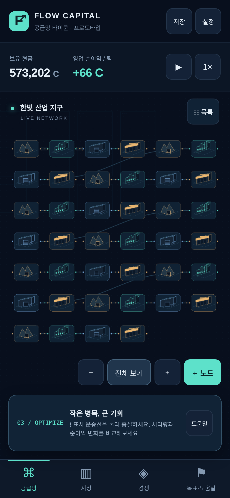

# FLOW CAPITAL · 방치형 공급망 타이쿤

**노드를 연결하면 상품이 흐르고, 병목을 풀면 수익이 자랍니다.**

오리지널 싱글플레이 경제 게임의 **수직 슬라이스 프로토타입 0.11.0**입니다. 한빛 산업 지구에서 목재를 조달하고 종이·가구를 생산해 가격 경쟁을 경험합니다. 별도 서버, 로그인, 외부 AI, 외부 이미지·음원·라이브러리 다운로드가 필요하지 않습니다.

> 이 버전은 완성된 v1 정식판이 아닙니다. 부채/인재/계약 모델·3도시 이상·24시간 확장 연구는 미구현이며, 연구는 기초 3기술과 클라우드 연산 해금만 있습니다. 금융A/B/C와 최대8시간 복귀정산의 기초를 지원합니다. 여기서는 생산→운송→판매→경쟁 반응의 첫 10분을 검증합니다.

[지금 플레이하기](https://sigco3111.github.io/supply-chain-tycoon/) · [저장소](https://github.com/sigco3111/supply-chain-tycoon)

## 0.11.0 오프라인 정산

- 마지막 정산시각부터 최대8시간, 같은1초경제틱을 작업스레드에서 계산합니다. 고정 수익률 배수나 재고복제는 없습니다. 렌더/입자를 만들지 않고600틱마다 진행률을 돌려줍니다. 1×실시간 기준이며 연구24시간 확장은 아직 없습니다.
- 내 회사·자회사는 설정의 현금안전선(0/5,000기본/10,000/20,000 C) 아래에서 생산·물류·판매·임대료·연구를 함께 중지합니다. 적자라인만 고르는 최적화는 아직 없고 회사단위 안전중단입니다. 중지 후 무료생산·음수현금은 없습니다. 경쟁사는 자체 자금으로 가격/확장/매집/연구를 계속합니다.
- 인수 최종판정·파산확정·자동 신주발행(IPO/백기사/포이즌필)을 보류합니다. 기존주문/공개매수는 실제 예약금으로 정산하고 지분매집은 계속합니다. 복귀시 경보대응을300틱(5게임일) 다시 주며 도산보류회사도300틱 유예합니다. 부채·이자·대출·소문모델 자체가 없으므로 미지급이자 구현을 뜻하지 않습니다.
- 복귀보고서: 경과/반영/가동/안전중단시간, 매출·원가·물류·고정비·전력·광고·순현금, 연구완료·품절·경쟁현금변화·마지막 뉴스·시장점유율·보류위험. 설정에서 최근보고서를 다시 엽니다. 보고서를 열 때 스크롤을 처음으로 돌립니다.
- 계산완료 상태와 소비시각을 하나의IndexedDB트랜잭션으로 저장한 뒤 교체합니다. 저장실패/작업실패는 원본을 유지하고 정지하며 재시도/원본JSON을 제공합니다. 중간에 닫으면 기존 저장부터 다시 계산하지만 중간수익은 먼저 반영하지 않습니다.
- 음수 경과0·8시간초과절삭. 같은구간 재접속 중복수령0. 서버없는 싱글플레이여서 시계조작/수동백업 복원은 완전히 막을 수 없습니다. Web Locks 미지원환경은 안전상 읽기전용입니다. 새회사/JSON가져오기는 현재시각으로 시작하며 가져온파일의 오래된시간을 즉시보상하지 않습니다.
- 저장스키마10: v1~9를 비파괴이행하며 기존제조레시피·지분·현금·재고는 보존합니다. 신규오프라인설정/최근원장을 추가합니다. 게임데이터는 공개서버로 전송하지 않습니다.
- `node offline-test.mjs`: 안정구간600틱 온라인동일상태,8시간한도·재수령0·역시계0·안전중단원장/재고불변·인수/파산보류·복귀300틱·이행을 검사합니다. 기존경제/금융/인수/방어10,000틱 검사도 유지합니다. Chromium PC/390/320 복귀보고서·새로고침·두번째탭·설정검증. Safari실기기검증과24시간연구·장기밸런스는 미완료입니다.

## 이전 버전 기록

아래 미구현/스키마 표기는 각 출시 당시의 기록입니다. 현재 범위는 위0.11.0 설명을 기준으로 합니다.

### 0.10.0 미니맵

선택한 회사·도시의 전체 노드/연결과 현재화면 사각형을 작은 Canvas로 표시합니다. 클릭/터치·드래그로 중심을 이동하고 지도에 포커스한뒤 방향키로 이동합니다. PC는 펼침,모바일은 접힌 버튼으로 시작합니다. 펼쳐진 지도만터치를 받으며 토글로 다시 접습니다. 보이지않는 경쟁사망/다른도시망은 그리지 않습니다. 구조/좌표가 바뀔때 지도배경을 캐시하고 카메라사각형만 프레임별 갱신합니다. 지도이동은 경제거래·생산·저장노드를 바꾸지 않습니다. 저장스키마9 유지.

검증:40노드 PC/390모바일에서 클릭/드래그/방향키·접기/펼치기,노드/현금/틱불변,자회사전환·잠긴도시·320폭지도/하단탭 경계와 금융방어/복구 회귀. 화면밖 노드는 전체지도에서 찾고 이동 후 목록/줌으로 자세히 봅니다. 이 빌드도 아직 실제장기오프라인정산과 실기기검증이 없는 프로토타입입니다.

## 0.9.0 금융 C: 공격·방어·지배권 상실

금융A/B/C의 게임플레이 기초는 연결됐지만 정식판이 아닙니다. 부채/인재/임대계약·오프라인러너·실기기검증·장기밸런스는 아직 없습니다. 금융은 실제결제/외부금융과 관계없는 게임용 모델입니다.

- 메이저 독립회사는 월1800틱에 인수예산을 평가합니다. 실제현금50,000 C 이상,공개매수40%이하 또는 장내주문10%이하 예산만 사용합니다. 상장직후 플레이어는1800틱 보호하며 비상장 플레이어는 공격하지 않습니다. 보호 이후 가장 저렴한 대상부터 평가하고 모든 회사가 동일 거래/원장/순환금지 규칙을 통과해야 합니다. 새 창업자/신주발행 외 무료현금 보충은 없습니다. AI방어는 일경계에 경보를 평가하며 플레이어방어는 직접선택입니다.
- 소각확인창에 각 기업주주비율 전/후를 표시합니다. 소각이 공격자비율까지 높이면 경고합니다. 소각은 언제나 안전한 방어가 아닙니다.
- 백기사: 유한한 우호투자자 초기500,000 C에서10~100신주를10%할인가로 사고 회사에 대금−2%수수료가 들어옵니다. 창업자/공격자 희석·우호지분율을 표시합니다. 계약1800틱(30일),양의일영업이익×우호지분율×10%를 실제회사현금한도로 배분합니다. 종료300틱전 경고하고 만료뒤 배분/우호응모거부가 끝나 일반투자자 지분으로 남습니다. 계약/쿨다운 중 재계약불가. 무료·영구동맹/방어보장 없음.
- 포이즌필: 독립상장회사에서1200 C 사전설정. 공격자직접지분35%시1회 발동하고 공격자외 주주가 주가30%할인으로 자기돈을 내고 신주를 받습니다. 기존보유주수 이하/계획시총주식40%·최대100주/총주식100,000주 상한. 창업자개인돈0이면 창업자도 행사불가. 돈이 없어0주만 행사돼도 발동소모,1800틱쿨다운·모든도시브랜드5%하락. 행사비는 회사현금 유입,설정비는 수수료원장. 실제법률·권리계획 재현 아님.
- 20%/35%경보후 최소5일 지나 공격자직접지분50%초과가 남으면 온라인 지배권상실화면이 뜨고 진행을 중지합니다. 창업자주식은 자동매도되지 않습니다. 회사·주식·설비원장은 보존하며 결과JSON내보내기,최근방어체크포인트/정상세대복구,새회사시작을 제공합니다. 복구저장은 같은 회사시작 식별자만 허용하며 다른 게임의 체크포인트는 거부합니다. 브라우저저장실패/삭제시 복구를 보장하지 않습니다.
- 오프라인 러너에 넘길 `step(state,{offline:true})`는 플레이어최종상실만 보류합니다. 현재 앱은 닫힌동안 시간을 멈추며 실제장기정산/복귀응답창은 다음 오프라인 작업에서 구현합니다. 보류훅만으로 오프라인기능 완료라 하지 않습니다.
- 저장스키마9. v1~8의 현금/예약/지분/자회사 보존,우호투자자 자금·방어/계약/상실/회사시작 식별자 추가. 구형상장플레이어는 이전시점부터1800틱 보호합니다. 회사금융현금+대중현금+우호현금+창업자개인현금+수수료+장내/공개매수예약금=초기대중/우호현금합계를 항상 검증합니다.

추가 검증 `node defense-test.mjs`: 소각공격자비율상승,백기사유한자금/희석/배분/예고/만료,유료포이즌35%/주식상한/평판비용/무자금실패,5일지연상실·창업자보존·진행정지·저장/복구·오프라인보류,희석방어,실제돈월간AI/상장보호,전체회사10,000틱 현금보존. 고액/직접지분배치 테스트픽스처는 QA용이며 새게임에 제공하지 않습니다.

## 0.8.0 금융 B: 공개매수·지배권·자회사

금융 C(AI 공격·백기사·포이즌필·피인수 결과)는 아직 없습니다. 이 빌드는 플레이어의 인수 성공과 소수주주 원장/자회사 운영을 검증합니다. 부채·인재·임대계약 모델 자체가 없어서 인수 검토창에0 C/미구현이라고 명시합니다.

- 공개매수/비상장 협상매수: 대상·제시가·목표수량·5~20게임일 기간을 정하고 최대대금+2%수수료를 예약합니다. 최소기간이 끝난 뒤 첫 게임일 경계에 정산합니다. 취소/대상도산/순환출자/매수회사가 인수되면 잔액을 환급합니다. 게임용 규칙이며 실제 법률이나 금융제도의 재현이 아닙니다.
- 대중은 체결일 주가대비 프리미엄에 비례해 응모하고20%면 전량입니다. AI 창업자는20%(기술선점형25%) 이상,다른 기업주주는15% 이상에서 응모합니다. 내 창업자 주식은 동의 없이 응모하지 않습니다. 응모초과는 정수 비례배분+최대나머지 방식,미달은 부분체결하고 잔액/미사용수수료를 돌려줍니다. 예상응모는 확정수량이 아닙니다.
- 매수대금은 대중/기업주주/AI 창업자 개인현금에 지급하며 대상회사현금은 늘지 않습니다. 개인현금과 기업현금은 별도입니다. 금융자금 보존식에 창업자현금과 공개매수예약금도 포함합니다.
- 직접 의결권20%/35% 경보가 뜨면 최소5게임일 대응창을 둡니다. 대응기간 뒤 직접지분이 **50%초과**일 때만 지배권을 얻습니다. 정확히50%는 성공하지 않습니다. 장내매집도 같은 경보/지연판정이며 자회사우회매집·순환출자는 체결 때도 막습니다.
- 인수회사는 기존 회사객체·노드·재고·현금·브랜드·소수주주를 유지하고 AI 독립가격/확장/인수전략을 멈춥니다. 기존 노드를 본사로 복제하지 않습니다. 자회사는 자기현금으로 계속 비용을 내고 생산·판매합니다. 운영회사 선택에서 자회사 공급망/가격/설비/광고/연구/도시를 관리하며 화면에는 선택한 회사의 네트워크 하나만 그립니다.
- 그룹 기술을 공유합니다. 같은 기술을 자회사와 본사가 동시에 연구했다면 이미 공유된 진행은 종료되고 기존 연구비를 소급 환급하지 않습니다. 연결영업이익은 본사+자회사경제적지분×영업이익이며 다단계는 지분율을 곱합니다. 실제 현금배당이 아니며 회사별 현금은 별도입니다. 회사간 상품거래 모델은 없습니다.
- 본사↔지배자회사 재무이체를 별도확인 후 수행하며 양쪽 금융원장에 반영합니다. 이체는 영업이익이 아니고 소수주주가 있는 회사의 현금도 바꿉니다. 인수 후 잔여주식100%매입은 별도 매수로 선택할 수 있습니다.
- 영업중/인수상태인 마지막 경쟁사까지 지배하면 '시장 완전 지배'를 표시하고 신생진입을 멈춥니다. 도산회사는 경쟁에서 제외하되 기록과 자산은 보관합니다. 현재12기록 상한과 엔드게임 수렴밸런스는 여전히 프로토타입 한계입니다.
- 저장스키마8. v1~7의 현금/지분/미체결 장내주문은 그대로,신규 인수/창업자개인현금 원장을0에서 붙입니다. 공개매수예약금·경보시각·지배회사·소수주주를 검사하고 보존합니다. 악성확장키/자회사지배권 불일치/과반 없는 지배회사/잘못된예약금은 거부합니다.

검증: `node test.mjs`, `node finance-test.mjs`, `node takeover-test.mjs`. 인수 테스트는 예약/취소·비례배분·부분체결·창업자대금·50%실패·5일대응·비상장협상·잔여주주매입·미드데이 개시·자산복제없음·자회사 운영/편집/기술/손익·자금이체·10,000틱 현금원장·8개 완전지배를 포함합니다. 인수 테스트의 고액 시작자본은 QA용이며 실제 새게임에 제공하지 않습니다.

## 0.7.0 금융 A: 주식·IPO 기초

금융 전체 완성판이 아닙니다. 이 빌드는 주식 원장·상장·장내 거래·자사주 소각까지만 포함합니다. 공개매수·과반 경영권·자회사·방어3종·피인수/완전지배 판정은 다음 금융 B/C 범위입니다. 게임용 크레딧만 사용하며 실제 금융·현금 결제와 관계없습니다.

- 플레이어/마이너는 창업자100주·100% 비상장. 초기 메이저3곳은 총200주(창업자100·대중100) 상장사입니다. 초기 대중 지분은 시작 소유자산이며 IPO 현금 유입을 소급해서 만들지 않습니다.
- 플레이어는600틱 후10~100주 IPO/신주발행을 직접 선택합니다. 발행420틱 간격, 수수료2%, 대중 투자자 초기현금2,000,000 C를 실제로 차감합니다. 회사현금은 발행대금−수수료만 증가하고 창업자 주식 수는 유지되어 지분율이 희석됩니다. 경쟁사는 영업이익50,000·현금40,000·운영1800틱 이후 유한한 대중자금으로 성장 상장을 선택합니다.
- 장내 주문은 회사당 미체결1건, 발행주식10%/게임일 한도와 유통/보유수량 한도입니다. 다음60틱 경계에 체결하고 매수대금+2%수수료를 먼저 예약합니다. 취소·파산·순환출자 발생 등 체결 불가면 전액 환급합니다. 매도는 체결 때 대중현금에서 매도회사에 지급하므로 대상회사의 현금은 늘지 않습니다. 가격은 수량별 충격을 반영합니다.
- 자사주 매입은 하루1회, 유통/총주식10% 한도로 대중지분을 현금으로 사 즉시 소각합니다. 창업자뿐 아니라 모든 잔여주주의 비율이 올라갑니다. 지금 빌드는 창업자비율만 확인창에 표시하며 공격자 상세경고는 금융 C에서 확장합니다.
- 원장은 창업자+기업+대중=발행주식, 정수주식, 자기 회사 직접매수·순환출자 금지입니다. 창업자지분은 자동매도하지 않습니다. 금융현금은 영업손익과 별도 누적하고 회사금융현금변화+대중현금+수수료+예약금=초기대중자금을 검증합니다.
- 주가는 실제60틱 영업이익 합계를 최근28일로 모으고, 설비 기본가격×레벨의60%와 현금으로 만든 게임용 자산하한/이익20배 목표로 완만하게 이동합니다. 일반 일 변동 상한±12%, 주가상한10,000,000 C·주식상한100,000주입니다. 부채/성장 프리미엄/뉴스는 아직 없으며 가치평가나 수익을 보장하지 않습니다.
- 저장스키마7. v1~6의 현금·노드·연구·도시·경쟁사에 금융초기 원장을 붙이고, 기존 현금은 바꾸지 않습니다. 불러온 날의 이전 부분 영업이익은 기록이 없어서 금융평균에서 제외합니다. 미체결 주문·예약금을 저장하고 위조 금액/주식합계/수수료/중복주문/순환소유를 거부합니다.
- 금융 탭과 PC/모바일 바텀시트에서 가격·시가총액·지분·평균영업이익·주문을 봅니다. 확인창은 수량·수수료·현금변화·비율·체결일을 보여주고 조건이 바뀌면 다시 확인합니다. 편집 되돌리기로 경제 거래를 취소하지 않습니다.

검증: `node test.mjs` + `node finance-test.mjs`. 금융 전용 검증은 IPO희석/자금이동, 소각, 예약·취소, 매수·매도, 파산환급, 같은날 상호주문 순환 차단, 위조저장 거부와10,000틱 자금/주식/일영업이익 보존을 포함합니다. IPO600틱은 기능 검증용 수치이며 기획서60~90분 목표 밸런스는 아직 맞추지 않았습니다.

## 0.6.0 계급형 경쟁사

기획서의 메이저/마이너 구조를 따릅니다. 기본 **8개(메이저3 + 마이너5)**이며 신생은 마이너로 진입한 뒤 성장 조건으로 승격합니다. 모든 회사가 동일 생산·운송·판매·현금·브랜드·연구 규칙을 사용합니다. 총수요가 회사 수만큼 복제되지 않습니다.

|초기 회사|계급|성격|초기 현금|시작 산업/도시|
|---|---|---|---:|---|
|바닥상사|메이저|가격 덤핑|35,000|한빛 종이, 기존 AI 보존|
|오로라그룹|메이저|브랜드 프리미엄|75,000|철원항 가구|
|노바테크|메이저|기술 선점|60,000|철원항 서비스|
|한빛제지|마이너|지역 생산|30,000|한빛 종이, 1,800틱 후 시작|
|철원가구|마이너|지역 생산|30,000|철원항 가구|
|바른포장|마이너|지역 생산|30,000|철원항 포장재|
|새빛데이터|마이너|지역 생산|22,000|한빛 서비스, 1,800틱 후 시작|
|신생공방|마이너|지역 생산|22,000|한빛 가구, 1,800틱 후 시작|

- **시작 자산 공개:** 표의 현금 외 초기 공급망이 제공됩니다. 서비스 회사는 공정/클라우드 해금, 포장 회사는 공정/포장 해금을 시작 자산으로 갖습니다. 초기 설비는 현금 차감 전의 창업자 자산입니다. 그 이후 건설·물류·광고·연구·도시 진출은 자기 현금에서 지불합니다. 공급/재고/수요 무료 보정은 없습니다.
- **성격:** 덤핑은 낮은 가격·빠른 가격 반응, 프리미엄은 더 높은 판매가와 광고 예산, 기술 선점은 클라우드 연구 우선입니다. 메이저는 연구·광고·디지털·항만 확장이 가능하고, 마이너는 지역 생산·가격 반응과 240틱마다 여유 현금으로 제한적 물류 개선만 수행합니다. 실제 주식 공격·인수는 다음 금융 빌드 범위입니다.
- **초기 보호:** 신규 한빛 회사는 1,800틱(1배속30분) 동안 대기합니다. 다른 도시 초기 회사는 실제로 운영합니다. 신규 메이저 확장은 초기1,800틱 이후, 기존 바닥상사는 이전 전략을 이어갑니다. 대기 중 회사는 비용·판매·전략을 멈춥니다. 구형 저장의 추가 회사는 현재 틱으로부터 최소600틱 유예를 받습니다.
- **성장:** 누적 영업이익80,000 C + 현금65,000 C + 업력1,800틱을 모두 충족한 마이너는 빈 메이저 자리(최대4개)로 승격합니다. 자산/현금을 새로 만들지 않고 성격을 기술 선점으로 바꿉니다.
- **도산/진입:** 고정비 지급 불가가180틱 연속이면 영업을 중지합니다. 회사/재고/설비/원장은 보존합니다. 매3,600틱 빈자리가 있으면 새 창업자 초기 현금22,000 C와 소규모 공급망으로 마이너가 진입합니다. 현재 기록 최대12개에는 도산/인수 회사도 포함하므로 무한 재진입이 아닙니다. 청산/보관함/인수 후 자산 통합은 금융 단계에서 다룹니다.
- **화면/성능:** 경쟁 탭의 메이저/마이너/도산 필터와 회사 상세에서 성격·현금·영업이익·선택 도시 판매량을 확인합니다. AI망은 Canvas로 그리지 않습니다. 회사 카드 DOM은 목록 구조가 바뀔 때만 만들고 수치는 경제 틱에 갱신합니다. 시장은 경쟁사 판매가 범위와 모든 회사 실제 판매 합계로 점유율을 표시합니다.
- **저장:** schema1~5→6. 플레이어와 기존 바닥상사의 현금·노드·재고·기술·항로를 보존하며, 신규 회사의 초기 자본만 별도 추가됩니다. 새 회사는 기존 회사 현금/수요를 복제하지 않습니다.
- **검사:**8개 회사10,000틱별 현금 원장·재고/전송 중 물량 보존, 모든 도시/상품 총판매≤수요,180틱 도산/3,600틱 진입/성장 승격,기존 노드 회귀. UI는8개/3·5필터,상세,구형 저장 현금 보존/600틱 유예,저장 복원,390px 터치·320px 넘침을 검사합니다. 실제 Safari 검증은 아닙니다.

## 0.5.0 항만 + 두 번째 도시

상단 도시 버튼으로 **한빛/철원항**을 전환합니다. 화면에는 선택 도시의 플레이어 네트워크만 그리고, 다른 도시와 AI 네트워크는 그리지 않습니다. 현금과 영업이익은 회사 전체입니다. 시장의 시세·수요·가격·브랜드·판매량은 선택 도시 기준입니다.

1. 한빛에서 제조 상품(종이/가구/포장재)을 선택하고 항만을 건설합니다. 항만 8,500 C, 한빛 유지 12 C/틱, Lv.1 재고 40칸. 서비스는 항만에 실을 수 없습니다.
2. 철원항 버튼 또는 항만 패널의 진출 안내에서 **12,000 C** 일시 진출비를 확인 후 지불합니다. 한빛 항만과 예비 현금 5,000 C가 필요합니다. 같은 도시 진출비는 중복 지불하지 않습니다. 진출비 환급/도시 철수는 미구현입니다.
3. 철원항에서 같은 상품 항만 → 현지 창고 → 매장을 건설·연결합니다. 제조/디지털 설비도 현지에서 새로 지을 수 있습니다. 설비는 자동 생성되지 않습니다.
4. 한빛 공장/창고를 한빛 항만에 연결하고, 항만 패널에서 철원항의 같은 상품 항만을 선택해 **항로 연결**합니다. 일반 노드 직접 도시 간 연결은 금지합니다. 순환 항로도 금지합니다.
5. 항로는 **6 C/개, 최소 3틱** 지연입니다. 한 번에 한 묶음만 운송하므로 초기 2개 묶음은 최대 약 2/3개·틱입니다. 항로 증설로 묶음을 4/8개로 늘릴 수 있습니다. 도착항 만재면 화물이 이동 중 상태로 기다립니다. 다른 도시 선은 보드에 그리지 않으며 항만 패널의 입항/출항 상세에서 용량·화물·비용을 봅니다.

|도시|초기 종이 수요|가구|포장재|서비스|고정비|
|---|---:|---:|---:|---:|---|
|한빛|4|2|2|2|기본|
|철원항|2|3|4|1|노드별 기본 고정비 ×1.2, 올림|

수요는 게임 내 일별 순환으로 변합니다. 광고는 해당 도시 상품의 브랜드만 키웁니다. 디지털 산업은 현지에 새로 지을 수 있지만 항만으로 전송하지 않습니다. 연구는 회사 공통으로 적용됩니다. 바닥상사는 자기 현금으로 진출비·양쪽 항만·현지 판매망과 운송비를 지불합니다.

schema1/2/3/4 저장을 schema5로 복사·검증합니다. 기존 노드는 한빛에 배치하고 현금·기술·재고·진행을 유지하며 철원항은 잠겨 있습니다. 저장/복원은 회사 전체이고 도시 화면을 바꿔도 다른 도시 운영은 계속됩니다. 새 회사/이전 저장 가져오기는 잠긴 도시 화면에 남지 않습니다.

검사: 진출비 중복 차감 방지, 잠긴 도시 건설 차단, 동일 상품 항만 간 연결만 허용, 3틱 지연/6 C 운임, 지역 가격·브랜드 분리, 원장/물량 10,000틱 보존(항로 화물 포함), AI 유료 진출, 항만 철거 시 화물 폐기. PC UI에서 진출→양쪽 항만→현지 판매→도시별 가격→저장 복원, 모바일390/320px에서 도시 전환·터치 패널·화면 넘침을 검사합니다. 실제 iPhone Safari 검증은 아닙니다.

## 0.4.0 데이터센터 마일스톤

제조와 별도인 디지털 산업입니다. 연구소의 **클라우드 연산**(공정 최적화 선행, 9,000 C, 180P)을 완료한 후 아래 전용 설비를 지으세요.

|노드|건설비|유지비/틱|처리량 Lv.1|변환과 변동비|
|---|---:|---:|---:|---|
|데이터 수집센터|5,500 C|7 C|3/틱|데이터 1 생산에 전력 8 C|
|연산 데이터센터|11,000 C|18 C|2/틱|데이터 2 → 서비스 1, 전력/연산 40 C|
|서비스 판매 허브|6,500 C|9 C|2/틱|서비스를 별도 수요에 판매|

- 수집센터 → 연산센터 → 허브를 연결합니다. 디지털 전용 연결은 대역폭과 전송비 1 C/단위, 최소 1틱 지연을 갖습니다. 제조 창고/공장/매장과 연결할 수 없습니다.
- 서비스 기준 판매가 420 C, 초기 수요 2/틱. 제조와 같은 가격/브랜드/품절 재배분 규칙을 사용하되 별도 시세·수요·재고입니다. 시장에서 서비스 판매가를 바꿉니다. 서비스 광고는 대행사 세부 설정에서 해금 후 선택합니다.
- 전력/연산비는 손익·현금 원장의 별도 항목입니다. 제조의 공정 효율은 연산비를 할인하지 않으며 물류 연구도 디지털 전송비를 바꾸지 않습니다.
- 데이터는 내부 중간 상품이고 직접 판매하지 않습니다. 서비스 재고는 이번 프로토타입에서 이월되며 만료/구독 청구/실제 전력망은 구현하지 않습니다. 실제 클라우드 계정이나 비용과 무관한 게임용 모델입니다.
- 종이/가구/포장재 제조 레시피는 변경하지 않았습니다. AI도 연구/설비/전력비를 자기 현금으로 지불하고 같은 규칙으로 진출합니다.
- schema 1/2/3 저장을 4로 복사·검증해 이전 현금·노드·재고·기술·진행 틱을 유지합니다. 기존 저장은 디지털 산업을 자동 해금하지 않습니다.
- 10,000틱 데이터 환산 보존(서비스 1=데이터 2, 전송 중 재고 포함), 전력 포함 현금 원장·손익 일치, 제조/디지털 연결 차단, AI 서비스 진출을 검사했습니다. PC/390px 터치/320px UI에서 연구·건설·연결·판매·저장 복원을 검사합니다. 실제 iPhone Safari 장시간 발열 검증은 별도입니다.

## 0.3.0 연구소 마일스톤

연구소와 1슬롯 기술 트리를 추가했습니다. 지원 노드 연구소 건설 7,000 C, 유지 10 C/틱. 연구소 레벨 합당 1포인트/틱이며 회사 전체 최대 3P/틱입니다. 기술은 선행 조건과 일시 연구비를 충족한 뒤 포인트를 쌓아 완료합니다.

| 기술 | 선행 | 일시 연구비 | 포인트 | 효과 |
|---|---|---:|---:|---|
| 공정 최적화 | 없음 | 4,500 C | 90P | 가공비 20% 절감, 정수 단위 반올림 |
| 포장재 공정 | 공정 최적화 | 6,000 C | 120P | 종이 2 → 포장재 1 생산/판매/광고 해금 |
| 물류 최적화 | 공정 최적화 | 5,500 C | 120P | 기본 운송비 2 → 1 C/개 |

연구비는 영업 순이익의 틱 비용이 아닌 일시 투자 원장에 기록됩니다. 연구 시작 후 비용 환급이나 중복 시작은 없습니다. 예비 현금 5,000 C가 필요하며, 현금 안전선 아래·운영 중단·연구소 없음에서는 진행을 멈춥니다. 연구소를 철거해도 완료 기술과 진행 포인트는 남습니다. 다시 연구소를 지으면 이어집니다.

기존 종이·가구 레시피는 유지했습니다. 포장재는 신상품 해금과 2단계 공급망을 검증하는 중간재 라인입니다. 기존 종이 공장 출력 → 포장재 공장 → 포장재 창고 → 포장재 매장. 포장 식품은 추후 농산 조달과 이 포장재를 결합할 콘텐츠로 남깁니다. 포장재 기준가격 350 C, 기본 수요 2개/틱, 가공 24 C(공정 최적화 후 19 C)입니다. 바닥상사도 자기 자금으로 연구소를 건설하고 공정·물류 효율을 연구합니다.

schemaVersion 1/2 저장은 3으로 비파괴 이전합니다. 기존 진행·현금·브랜드는 유지하고 연구/포장재 재고를 0으로 추가합니다. 기존 저장 파일을 덮어쓰기 전에 원본 JSON 보관을 권합니다.

테스트: 연구소 없을 때 시작 차단, 선행 조건, 중복 비용 차단, 철거 시 진행 중지·재건 후 재개, 90P/120P 완료, 포장재 생산·판매, 연구비 포함 현금 원장 10,000틱을 확인했습니다. 별도로 종이→포장재 변환과 운송 중 재고를 포함한 목재 환산 물량 보존을 10,000틱 매 틱 검사했습니다. 모바일에서 기존 v2 저장 가져오기→연구소 건설→공정 연구→포장재 연구→저장/새로고침 후 해금 유지도 확인했습니다.

## 0.2.0 광고 대행사 마일스톤

기본 4종에 **광고 대행사**를 추가했습니다. `＋ 노드`에서 상품을 고르고 건설한 뒤 대행사를 선택해 광고 예산을 정하세요.

- 건설 6,500 C, 유지 6 C/틱, 기본 광고 예산 0(직접 켜기). 광고비 0/10/25/50/100 C/틱.
- 지금은 한빛 도시의 종이/가구별 브랜드입니다. 상품 운송 연결은 필요 없고 광고 노드로 운송선을 만들 수 없습니다.
- 브랜드는 0~100(내부 정수 0~10,000), 매 틱 감소, 총 광고비에 체감효과. 같은 상품의 대행사를 여러 개 지어도 비용 합계에 체감효과가 적용됩니다.
- 비용을 낸 광고는 인지도→판매 선택 가중치를 높입니다. 도시 총수요는 변하지 않으며, 재고·매장 한도·가격이 여전히 판매를 제한합니다. 광고는 확정 수익이나 품절 해결책이 아닙니다.
- 현금 5,000 C 미만에서는 광고비를 자동 중단합니다. 대행사 고정비는 그대로 있으므로 적자를 자동 제거하는 기능은 아닙니다.
- 광고비를 영업 손익과 현금 원장에 별도 기록합니다. 바닥상사도 자기 돈으로 대행사를 건설하고 같은 광고비/브랜드 규칙을 쓰며 현금·판매에 따라 예산을 조정합니다.
- 기존 schemaVersion 1 저장을 2로 이전합니다. 현금·재고·노드·진행은 보존하고 브랜드 0·광고비 0으로 시작합니다. 입력 저장 원본을 변경하지 않고 복사 후 검사합니다.
- 광고 단독 노드 검증: 10,000틱 현금 원장, 브랜드 상한, 감소, 안전선 중단. 같은 가격·매장 공급 조건의 59틱 시험에서 브랜드 0은 177개, 초기 브랜드 100은 236개 판매했으며 매 틱 전체 판매는 동일한 5개 수요 안에 있었습니다. 초기 브랜드 100은 QA 상태이며 플레이에서 무료로 주는 값이 아닙니다.

데이터센터는 0.4.0의 독립 디지털 산업으로 구현했습니다. 항만·한빛/철원항 2도시는 0.5.0으로 구현했습니다. 연구소는 기초 기술 트리와 클라우드 해금을 지원합니다. v1 정식판이 아닌 단계별 개발 빌드이며 금융 필수 범위는 그대로 남아 있습니다.

## 이번 버전

| 영역 | 내용 |
|---|---|
| 도시·상품 | 가상 도시 한빛, 완제품 종이·가구, 공용 원료 목재 |
| 공급망 | 채굴장 / 공장 / 물류창고 / 매장. 자유 배치·드래그·그리드 스냅 |
| 연결 | 선택→출력 연결→대상 선택. 상품 호환성·중복·순환 검사 |
| 물류 | 연결별 용량과 1틱 운송 지연, 운송 중 재고, 실물 상품과 독립된 시각 입자 |
| 병목 | 운송 포화 `!`, 원료 부족, 출력 만재, 품절·판매 부진 표시 |
| 투자 | 설비 Lv.1~5, 운송 1~8개/틱, 건설·증설 비용과 유지비 |
| 시장 | 일별 시세·수요, 직접 판매가 조정, 가중 수요 배분·품절 재배분 |
| 경쟁 | 바닥상사 1개. 동일 경제 함수, 일별 가격 반응, 자기 자금으로 물류 증설 |
| 기록 | 매출·원료비·가공비·운송비·고정비·순이익 분리, 최근 28일 그래프·뉴스 |
| 저장 | IndexedDB, 15초 자동·수동 저장, 이전 세대 복구, JSON 내보내기/가져오기 |
| 조작 | PC 마우스/휠, 모바일 터치/핀치, 한 패널·바텀시트, 44px 버튼 |
| 넓은 보드 | 줌 단계별 상세→요약→아이콘 표시, 노드 이름·상품·상태 검색, 해당 위치 바로 이동 |
| 설정 | 1·2·4배속, 일시정지, 저성능 모드, 모션 감소, 선택 합성 효과음 |

## 플레이 화면

PC에서 두 상품을 판매하는 실제 배포 화면입니다.



모바일 390px의 첫 공급망과 병목 표시입니다. 실제 iPhone Safari가 아닌 Chromium 터치 에뮬레이션 캡처입니다.



아래는 40노드·30연결 **시험 저장 파일**을 불러와 전체 보기한 모습입니다. 작은 수치를 숨기고 아이콘으로 요약하며, 목록 검색으로 원하는 노드에 확대 이동합니다. 실제 40개 공장이 모두 흑자 운영된다는 뜻은 아닙니다.



## 첫 10분 가이드

1. **채굴장 선택 → 출력 연결 → 공장 선택.** 공장→물류창고→매장도 연결합니다.
2. 원료가 공장에 도착해 종이가 됩니다. 매장 입고 후 자동 판매됩니다. 최소 운송 지연은 연결마다 1틱입니다.
3. `!`가 보이는 운송선을 누르고 용량을 늘립니다. 매출뿐 아니라 순이익 변화를 비교하세요.
4. `＋ 노드`에서 **가구**를 선택하고 공장·물류창고·매장을 건설하세요. 기존 채굴장을 분기하거나 새 채굴장을 건설합니다.
5. **시장** 탭에서 가격을 바꾸고 다음 게임일의 경쟁사 반응을 확인합니다.
6. **목표·도움말**에서 첫 매출, 물류 개선, 두 상품 판매, 영업이익, 10일 운영 목표를 확인합니다. 목표를 끝내도 계속 플레이할 수 있습니다.

시작 시 종이용 설비 4개는 배치되어 있지만 연결은 없습니다. 설비 자산을 제외한 운영 현금은 **32,000 C**입니다. 현금이 부족하면 자동으로 운영을 멈춥니다. 설비 철거는 기본가의 60%를 환급하며, 증설비·재고·운송 중 상품은 돌려주지 않습니다. 철거/연결 제거는 확인 후 진행합니다. **경제 거래를 되돌리는 Undo는 없습니다.**

### 시간과 가격

- 현실 1초 = 1틱(1배속), 60틱 = 게임 1일. 10게임일은 1배속 10분입니다.
- 생산·운송·판매는 틱 단위, 시세·수요·AI 가격 판단은 일 단위입니다.
- 원료 목재: 12 C/개. 종이: 목재 1 + 가공 12 C. 가구: 목재 3 + 가공 45 C.
- 운송비: 연결마다 2 C/개. 고정비는 노드 종류·레벨에 따라 추가됩니다.
- 시세는 최근 하루 공급과 수요를 보고 완만히 이동합니다. 회사 판매가는 별도이며, 시장에서 바꿀 수 있습니다.
- 가격 매력도는 지수 가중치로 계산하고 정수 수요를 배분합니다. 품절인 회사의 수요는 판매 가능한 회사로 돌아갑니다.
- 이 버전의 모든 밸런스 수치는 초기 튜닝값입니다. 가격 하나로 모든 상황을 이기는지, 장기 확장 압력이 적절한지는 추가 검증 대상입니다.

## 조작

| 동작 | 방법 |
|---|---|
| 노드 검사 | 노드를 클릭/탭 |
| 위치 변경 | 노드를 드래그 |
| 연결 | 노드 검사창 → 출력 연결 → 대상 노드 |
| 물류 검사 | 연결선이나 가운데 `개/t` 배지 클릭/탭 |
| 보드 이동 | 빈 곳 드래그 |
| 확대·축소 | PC 휠 / 모바일 두 손가락 핀치 / ± 버튼 |
| 전체 보기 | 전체 보기 버튼 |
| 편집 취소 | Esc / 연결 모드에서 빈 곳 탭 |
| 일시정지 | 상단 Ⅱ / 본문에 포커스가 있을 때 Space |

모바일은 기본 30fps 목표·DPR 1.5 상한입니다. PC는 기본 60fps 목표·DPR 2 상한입니다. **목표이지 모든 기기의 성능 보장은 아닙니다.** 보드 상한은 프로토타입 기준 40노드/100연결이며, 정식판의 200노드·400연결 예산을 검증한 버전이 아닙니다.

## 저장과 주의사항

- 데이터베이스: `flow-capital-prototype:saves`, 설정 키: `flow-capital-prototype:settings`.
- GitHub Pages의 다른 게임과 같은 origin을 써도 게임별 이름으로 분리됩니다.
- 저장 트랜잭션이 끝난 뒤에만 성공 표시를 합니다. 저장 거부/공간 부족 시 JSON 내보내기를 권합니다.
- 현재 세대와 이전 세대를 보관합니다. 수동 3슬롯은 아직 없습니다.
- JSON 가져오기는 2MB 상한, gameId/버전/정수 금액/재고/노드/연결/순환/기록 검사 후 확인을 받습니다.
- Web Locks 지원 브라우저는 한 탭만 운영·저장합니다. 두 번째 탭은 읽기 전용입니다. 미지원 브라우저에는 한 탭만 쓰라는 경고를 표시합니다.
- 기기 간 자동 동기화는 없습니다. 브라우저 데이터 삭제·비공개 모드·Safari의 데이터 정리로 유실될 수 있으니 JSON을 백업하세요.
- **백그라운드·닫힌 동안은 최대8시간 정산**합니다. 빠른배속과 관계없이 실제1초=1경제틱입니다. 일시정지 상태에서 닫아도 복귀정산은 작동합니다. 기기별 로컬저장과 단일탭 잠금을 사용하며 서버시계/클라우드저장은 없습니다.

## 코드 구조

```text
index.html   의미 있는 DOM UI와 화면 뼈대
style.css    모바일 우선 레이아웃·바텀시트·테마
sim.mjs      브라우저 API 없는 순수 결정론적 경제 코어·데이터·검증
app.js       입력·Canvas 렌더러·UI·IndexedDB 저장 어댑터
test.mjs    경제 회귀 테스트 (Node.js)
```

렌더링과 경제 계산을 분리했습니다. 노드 타일·벡터 아이콘·글로우·곡선 표본을 캐시하고, 상품 입자는 고정 풀(450개)을 재사용합니다. 줌아웃하면 세부 재고·작은 상태 글자를 숨기고 큰 아이콘과 종류만 보여주며, 더 멀어지면 아이콘만 남깁니다. 상단 `☷ 목록`에서 검색하면 해당 위치로 확대 이동할 수 있습니다. 미니맵은 모바일 보드를 가리지 않는 접이식 형태를 후속으로 검토합니다.

수치 DOM은 경제 틱이나 사용자 입력에서 갱신하며 매 프레임 전체 UI/차트를 만들지 않습니다. 경쟁사 네트워크는 경제 상태로만 유지하고 렌더하지 않습니다. 사운드는 사용자가 켰을 때 Web Audio로 합성합니다.

## 로컬 실행과 테스트

일반 정적 HTTP 서버로 폴더를 제공하세요. ES module이므로 `file://` 직접 열기는 권하지 않습니다.

```sh
python3 -m http.server 8000
# http://localhost:8000 에 접속
node test.mjs
node finance-test.mjs
node takeover-test.mjs
node defense-test.mjs
node offline-test.mjs
```

자동 테스트는 첫 판매, 병목 증설, 가구 라인 추가, 600틱 진행, 추가 6,000틱의 동일 입력 결정성·유효 상태 검사, 손상 금액 거부를 확인합니다. 별도 10,000틱 검사에서는 매 틱 현금 원장 및 목재·종이·가구·운송 중 재고 보존을 확인합니다. 테스트 속도는 실제 플레이 시간과 다릅니다.

## 현재 검증 범위와 다음 단계

- 로컬 Chromium에서 PC 1440px, 모바일 390px 레이아웃·첫 연결/판매·저장/새로고침·두 번째 탭 읽기 전용을 확인했습니다.
- 실제 GitHub Pages에서 PC 1440px, 모바일 390/320px의 연결·건설·증설·가격 변경·첫 판매·저장 복원을 확인했습니다.
- 실제 배포 UI 테스트에서 8노드/6연결, 종이 2개·가구 1개 판매, 순이익 +376 C/틱을 확인했습니다. 종이를 145 C로 올리자 다음 날 AI는 127 C로 반응했습니다. 이는 특정 테스트 상태의 결과이며 고정 수익을 보장하지 않습니다.
- 40노드/30연결 시험 보드에서 모바일 전체 보기·아이콘 요약·공장 10개 검색·위치 이동을 확인했습니다. 이는 배치/탐색 검증이며 200노드나 장시간 발열 검증이 아닙니다.
- 실제 iPhone Safari의 터치·오디오·발열·저장 지속성은 별도 실기기 확인이 필요합니다. Chromium의 모바일 에뮬레이션은 Safari 실기기 검증을 대체하지 않습니다.
- 다음 단계: 첫30분·장기 밸런스, 오프라인 연속복귀 스트레스·iPhone Safari실기기, 저장3슬롯·병목진단 개선. 부채/인재/계약과 추가도시는 별도미구현 범위입니다.

외부 게임의 코드·아트·UI를 복사하지 않았습니다. 현재 라이선스는 별도로 지정하지 않았습니다.
